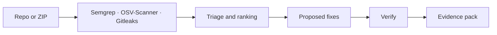
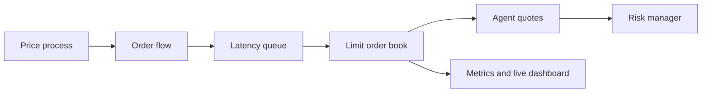
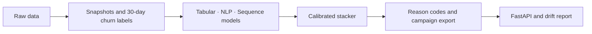
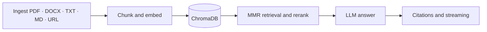

---

## About

I build AI systems that hold up outside a notebook: retrieval pipelines that cite their sources, models that explain their predictions, and scanners that find what is broken and propose the fix. Most of my work sits where machine learning meets security and infrastructure.

At Samsung R&D Institute Bangalore I work on applied ML and Generative AI research alongside senior research engineers, covering model development, experimentation and evaluation across deep learning, NLP and LLM-based systems.

**Open source**

- Ranked #1 overall among contributors at GirlScript Summer of Code
- Project Admin at Social Summer of Code: mentoring contributors, reviewing PRs, triaging issues
- Authored LangChain integration examples and RAG utilities used by 20+ developers

---

## Selected Work

### [PatchPilot](https://github.com/ionfwsrijan/PatchPilot)

*Automated code security triage: scan, fix, verify and export compliance evidence. Runs entirely locally.*

Under the hood

- Runs SAST, dependency and secret scanners in parallel against a ZIP upload or a GitHub repo
- LLM-assisted remediation with sub-150ms inference, followed by a verification pass that re-runs the checks
- ML layer for severity ranking, finding deduplication, false-positive filtering and fix-success prediction; local LLM patch generation via Ollama
- Exports a compliance evidence pack with audit artifacts and diffs
- Open source, with outside contributors

`Python` `FastAPI` `React` `Vite` `Tailwind` `Docker` `Semgrep` `OSV-Scanner` `Gitleaks`

### [Skewline](https://github.com/ionfwsrijan/Skewline)

*Research-grade limit-order-book simulator for benchmarking market making strategies under realistic microstructure constraints.*

Under the hood

- Benchmarks Avellaneda-Stoikov, GLFT, flow imbalance, tabular RL, DQN and multi-asset hedging under stochastic latency, adverse selection and partial fills
- Full-stack FastAPI and React dashboard with real-time WebSocket streaming
- Backtested against real Binance BTC, ETH and SOL trade data using KS-test distribution comparison
- 28+ automated tests, CI and Docker deployment

`Python` `FastAPI` `React` `NumPy` `WebSocket` `Docker`

### [Driftmark](https://github.com/ionfwsrijan/Driftmark)

*End-to-end churn prediction with explanations and monitoring built in.*

Under the hood

- Tabular (LightGBM), NLP and sequence models ensembled into a time-aware, calibrated stacker
- SHAP-based reason codes and automated CRM campaign exports
- FastAPI batch-scoring API with PSI-based drift monitoring

`Python` `LightGBM` `XGBoost` `SHAP` `FastAPI` `Poetry`

### [Lexivault](https://github.com/ionfwsrijan/Lexivault)

*RAG-based document Q&A with citations, built to be measured.*

Under the hood

- 90%+ answer relevance on an evaluation set
- Multi-format ingestion, SSE streaming and chunk-level citations
- Feedback loop, drift monitoring, evaluation and benchmark scripts
- CI/CD with Docker and GitHub Actions

`Python` `LangChain` `ChromaDB` `FastAPI` `OpenAI` `Docker` `GitHub Actions`

---

## Stack

**Languages**
&nbsp;

**ML and Generative AI**
&nbsp;

**Backend and Infrastructure**
&nbsp;

**Frontend**
&nbsp;

**Security Tooling**
&nbsp;

---

## Activity

  

---

*Building AI systems that don't just predict. They protect, explain and scale.*

[jaiswalsrijan505@gmail.com](mailto:jaiswalsrijan505@gmail.com)

